# 📁 VESTIGO™ — EXPEDIENTE DE CONTEXTO Y REGISTRO DE CAMBIOS (CHANGELOG)
> **Documento Maestro de Arquitectura, Intención de Producto y Registro Vivo de Evolución**  
> **Última Actualización:** 19 de Octubre de 2026 | **Versión Actual:** v1.2.0  
> **Ubicación del Proyecto:** `C:\Users\migue\.gemini\antigravity\scratch\crimenes-imperfectos-valdeluna\`
> **Repositorio Oficial en GitHub:** [https://github.com/mgesm/vestigo](https://github.com/mgesm/vestigo)

---

## 🎯 1. VISIÓN E INTENCIÓN DEL PROYECTO

### 1.1. ¿Qué es VESTIGO?
**VESTIGO** (del latín *vestigium*: rastro, huella, indicio) es una plataforma y aplicación de **investigación criminalística y deducción forense en formato híbrido**. 

Combina la tangibilidad del **material policial físico** (atestados oficiales, informes de autopsia, diligencias judiciales, fotografías de la escena con testigo métrico, actas notariales e interrogatorios) con el soporte tecnológico de una **terminal digital táctica** (lectura de matrículas DGT LPR, triangulación de antenas BTS, circuito cerrado CCTV, cálculo cartográfico SIG y reproductor de audios de emergencia).

### 1.2. Principios y Pilares de Diseño
1. **Realismo Forense y Judicial Implacable:**  
   No es un juego de pistas arbitrarias ni acertijos abstractos. Todo se basa en protocolos reales de la Guardia Civil (Unidad Orgánica de Policía Judicial), el Instituto Nacional de Toxicología y Ciencias Forenses (INTCF), el Servicio de Criminalística (SECRIM), documentoscopia, tanatología y la Dirección General de Tráfico (DGT).
2. **Lógica Deductiva Pura y Rigor Cronometrado:**  
   El caso se resuelve cruzando datos objetivos: concordancia de livideces cadavéricas, cronotanatodiagnóstico por contenido gástrico, tiempos de desplazamiento en carretera y el principio de transferencia de Locard (*"todo contacto deja un rastro"*).
3. **Regla de Oro: Cero Spoilers:**  
   El creador y los jugadores pueden preparar, imprimir e interactuar con la app y el vídeo briefing **sin conocer la identidad del culpable ni la solución de antemano**. La resolución final queda estrictamente sellada en un documento aislado (`SOLUCION_CONFIDENCIAL.md`).
4. **Escalabilidad de Producto (De Caso Piloto a App Universal):**  
   Aunque el proyecto nace con el caso piloto *"El Último Mosto de Bodegas Valdeluna"*, la arquitectura y la marca **VESTIGO** están diseñadas para convertirse en una aplicación comercial capaz de albergar una antología de casos criminales independientes.

---

## 🏗️ 2. ARQUITECTURA DEL ECOSISTEMA ACTUAL

El proyecto se estructura en **cuatro capas sinérgicas**:

```mermaid
flowchart TD
    A["VESTIGO: Plataforma"] --> B["1. Capa Física (Dossiers PDF)"]
    A --> C["2. Capa Digital (Terminal SITRA-JUD)"]
    A --> D["3. Capa Audiovisual (Vídeo Briefing)"]
    A --> E["4. Identidad de Marca (Branding & 2D Icon)"]

    B --> B1["Sobre A: Pieza Principal (Autopsia + Planos)"]
    B --> B2["Sobre B: Pieza Separada I (Interrogatorios + BTS)"]
    B --> B3["Sobre C: Pieza Convicción (DGT + SECRIM)"]
    B --> B4["Manual de Reglas (4 págs)"]
    B --> B5["Dossier Notarial & Forense (6 págs)"]
    B --> B6["Extras de Inmersión (Fichas + Hemeroteca)"]

    C --> C1["Lector LPR Tráfico DGT"]
    C --> C2["Mapa Táctico SIG Peñafiel"]
    C --> C3["CCTV & Sensores de Movimiento"]
    C --> C4["Audio 112 & Pistas Multinivel"]
    C --> C5["Validación Progresiva de Autos"]

    D --> D1["HUD Policial 16:9"]
    D --> D2["Web Audio API (Procedimental 55 Hz)"]
    D --> D3["Web Speech API (Voz en Castellano)"]
    D --> D4["6 Actos sin Spoilers"]

    E --> E1["Icono 2D Frontal (1024px PNG)"]
    E --> E2["Isotipo Vectorial 2D (SVG)"]
    E --> E3["Wordmark Oficial (SVG)"]
    E --> E4["Icono 3D Promocional"]
    E --> E5["Showcase Interactivo (branding/index.html)"]
```

---

## 📂 3. INVENTARIO COMPLETO DE ARCHIVOS Y MÓDULOS

### 📄 Capa de Documentación Física e Imprimibles (`documentos-imprimibles/`)
* **`index.html`:** Portal web centralizado de descarga e inspección de todos los dossiers.
* **`INSTRUCCIONES_DE_JUEGO.pdf` (4 págs / 1.03 MB):** Manual de operaciones, montaje de mesa, flujo de sobres y decálogo de deducción forense.
* **`SOBRE_A_PIEZA_PRINCIPAL.pdf` (6 págs / 651 KB):** Providencia judicial, atestado inicial de Peñafiel, autopsia preliminar completa en dos hojas (tanatología y digestión), plano arquitectónico acotado en SVG, ficha técnica de ventilación y albarán de catering.
* **`SOBRE_B_PIEZA_SEPARADA_1.pdf` (6 págs / 517 KB):** Acta de reactivo luminol (BlueStar), 4 transcripciones de interrogatorios policiales, vaciado de chats de WhatsApp, informe pericial de telefonía (antenas BTS) y acta de botellas sustraídas.
* **`SOBRE_C_PIEZA_CONVICCION.pdf` (4 págs / 570 KB):** Documentoscopia pericial con luz infrarroja del ticket de aparcamiento, reporte LPR cinemométrico de la DGT, auditoría contable de Delitos Económicos (UDEF) sobre el aval de 2,4 M€ y dictamen de espectrometría química definitiva de SECRIM (INTCF).
* **`EXTRAS_INMERSION.pdf` (5 págs / 4.91 MB):** Fichas de filiación con retratos biométricos y huellas de los 5 personajes, periódico *El Norte de Castilla*, cuaderno manuscrito del agente instructor y etiquetas oficiales recortables de cadena de custodia.
* **`DOSSIER_NOTARIAL_Y_FORENSE.pdf` (6 págs / 4.24 MB):** Copia simple de testamento notarial con timbres FNMT, extracto bancario de CaixaBank, libro oficial de pesaje de vendimia D.O. Ribera del Duero, auditoría de cerradura RFID de hotel, nota manuscrita arrugada y álbum fotográfico forense con regla métrica ABFO.

### 💻 Capa Digital e Interactiva (`terminal-policial/`)
* **`index.html`:** Terminal web militar/policial SITRA-JUD que incluye:
  - Consulta en tiempo real de matrículas en el radar LPR de la N-122.
  - Fototeca forense interactiva en alta resolución con testigos métricos.
  - Mapa táctico cartográfico interactivo con cálculo automático de distancias y tiempos de conducción.
  - Visor perimetral CCTV con registros cronológicos de sensores de presencia.
  - Simulador sonoro de llamada de emergencia al 112.
  - Sistema de desbloqueo judicial escalonado de sobres mediante deducción.
  - Central de pistas progresivas (Nivel 1, 2 y 3) para evitar bloqueos.

### 🎬 Capa Audiovisual y Briefing (`video-briefing/`)
* **`index.html`:** Reproductor cinematográfico 16:9 con estética de circuito clasificado.
  - Motor de audio procedural en tiempo real mediante **Web Audio API** (subgraves oscilantes a 55 Hz, intervalos armónicos a 82.4 Hz, pulsos cardíacos y ruido analógico).
  - Locución hablada en castellano mediante **Web Speech API** (`es-ES`) con subtítulos teletipo sincronizados.
  - Exposición de 6 actos narrativos con efecto Ken Burns sobre fotografías forenses y sospechosos (sin spoilers).

### 💎 Identidad de Marca y Aplicación (`branding/` e `imagenes/`)
* **`imagenes/vestigo_icon_2d.png`:** Icono oficial 2D plano (1024×1024 px) en vista ortográfica frontal para App Store / Google Play / Launcher.
* **`branding/vestigo_icon_2d.svg`:** Icono vectorial 2D escalable con filtros luminiscentes de luminol y retícula de precisión.
* **`branding/vestigo_wordmark.svg`:** Logotipo horizontal completo con tipografía display extendida.
* **`imagenes/vestigo_app_icon.png`:** Icono renderizado en 3D squircle para marketing y portadas.
* **`branding/index.html`:** Brand Showcase interactivo con visualización del icono en pantalla de iPhone y tokens de diseño.

### 🔒 Núcleo Secreto del Caso
* **`SOLUCION_CONFIDENCIAL.md`:** Archivo sellado que contiene la identidad del culpable, móvil económico/personal, reconstrucción cronológica al minuto y las claves forenses irrefutables. **No debe leerse antes de jugar.**

---

## 📝 4. REGISTRO HISTÓRICO DE CAMBIOS (CHANGELOG)

### [v1.2.0] — 2026-10-19
#### Añadido
- **Universal Responsive Web App Shell (`index.html`):** Punto de entrada unificado y responsive para **Móvil, iPad/Tablet y Ordenador de escritorio**.
- **Catálogo de Casos (`#view-catalog`):** Vista principal con ficha activa del *Caso 01: El Último Mosto de Bodegas Valdeluna* y fichas preparadas para futuros casos (*Caso 02: Marea Negra en Ría de Arousa* y *Caso 03: La Cripta de San Jerónimo*).
- **Espacio de Trabajo del Caso (`#view-case`):** Subnavegación desacoplada con 5 áreas de trabajo:
  1. *🎬 Vídeo Briefing:* Reproductor 16:9 integrado con Web Audio API y síntesis de voz.
  2. *📄 Dossiers & PDFs:* Rejilla de los 6 documentos oficiales (31 págs) con descargas directas y visores HTML.
  3. *💻 Terminal SITRA-JUD:* Terminal policial completa con radar DGT LPR, mapa táctico SIG, CCTV y validación judicial.
  4. *👥 Sospechosos & Escena:* Galería modal en alta definición con retratos fotorrealistas y fotos periciales con testigos métricos ABFO.
  5. *📓 Bloc de Notas del Investigador:* Cuaderno interactivo con guardado en tiempo real en `localStorage` para móviles y tablets.
- **Doble Navegación Responsiva Adaptativa:** Barra de navegación inferior fija para teléfonos móviles (`mobile-bottom-nav`) con soporte de área segura de iOS, y pestañas superiores para iPad y escritorio.
- **PWA & Offline Readiness:** Creación de `manifest.json` y `sw.js` (Service Worker) para instalación como App nativa en pantalla de inicio de iOS y Android.
- **Protocolo Autónomo de Creación de Casos (`PROTOCOLO_CREACION_CASOS.md`):** Guía maestra y sistema de ejecución para generar nuevos casos con rigor forense, 6 dossiers (31 págs), 9 activos fotográficos, terminal, vídeo briefing y auto-inyección en la app.
- **Integración con Repositorio GitHub:** Vinculación al repositorio remoto oficial `https://github.com/mgesm/vestigo.git` y configuración de `.gitignore`.

---

### [v1.1.0] — 2026-10-19
#### Añadido
- Creación de este documento maestro `CONTEXTO_PROYECTO.md` para centralizar la visión, arquitectura, inventario de archivos y changelog vivo de **VESTIGO**.
- Diseño y exportación del **Icono 2D Plano Oficial (Front-Facing)** `imagenes/vestigo_icon_2d.png` (1024×1024 px) en perspectiva ortográfica pura sin inclinaciones 3D.
- Creación del icono vectorial 2D limpio `branding/vestigo_icon_2d.svg`.
- Actualización de `branding/index.html` para incorporar el icono 2D en el visor principal, las escalas responsivas y el mockup de pantalla de inicio de iPhone.
- Actualización de la cabecera de la **Terminal Policial SITRA-JUD** (`terminal-policial/index.html`) con el nuevo icono 2D y accesos directos al Brand Showcase.

---

### [v1.0.0] — 2026-10-19
#### Añadido
- Creación de la identidad corporativa y nombre definitivo de la app: **VESTIGO** (del latín *vestigium*).
- Generación del primer App Icon 3D renderizado (`imagenes/vestigo_app_icon.png`) con textura de titanio y resplandor neón cian.
- Creación del logotipo vectorial completo horizontal `branding/vestigo_wordmark.svg`.
- Publicación del portal de diseño de marca `branding/index.html` con paleta cromática pericial (*Luminol Cyan*, *UV Flare*, *Evidence Hazard*, *Midnight Slate*, *Obsidian Black*).

---

### [v0.9.0] — 2026-10-17
#### Añadido
- Desarrollo del **Vídeo Briefing Judicial Narrado e Interactivo** (`video-briefing/index.html`).
- Implementación del sintetizador de audio procedimental con Web Audio API (drones subgraves, latidos de tensión, ruido analógico sin dependencias externas).
- Integración del motor de locución en castellano con Web Speech API y subtítulos sincronizados.
- Estructuración de los 6 actos cinemáticos de ambientación y reglas con estricto respeto a la regla de cero spoilers.
- Enlace al vídeo briefing desde la cabecera de la terminal policial y desde el hub de impresión.

---

### [v0.8.0] — 2026-10-17
#### Añadido
- Redacción y maquetación del **Manual del Investigador y Reglas de Juego** (`INSTRUCCIONES_DE_JUEGO.pdf`, 4 páginas).
- Inclusión del decálogo forense, instrucciones de preparación de sala y protocolo de precintado físico de sobres.

---

### [v0.7.0] — 2026-10-16
#### Añadido
- Generación de **retratos fotorrealistas con calidad documental judicial** para los 5 personajes: Gonzalo de la Serna, Marcos Varela, Lucía de la Serna, Javier Beltrán y Elena Fontanals (`imagenes/`).
- Generación de **fotografías forenses periciales de la escena del crimen** con reglas métricas ABFO: Nave 2 de cubas, laboratorio químico con reactivo derramado, calzado con alfombrilla y mirador del castillo de Peñafiel.
- Incorporación de la fototeca pericial en alta definición dentro de la terminal web.

---

### [v0.6.0] — 2026-10-16
#### Añadido
- Creación del **Dossier Notarial y Forense de Coleccionista** (`DOSSIER_NOTARIAL_Y_FORENSE.pdf`, 6 páginas).
- Inclusión de testamento notarial con timbres FNMT, extracto oficial CaixaBank, registro de pesaje D.O. Ribera del Duero, auditoría telemática de cerradura RFID y álbum pericial.

---

### [v0.5.0] — 2026-10-16
#### Corregido & Optimizado
- Detección y corrección de saltos de página y solapamientos en los PDFs imprimibles.
- Automatización de la compilación mediante script PowerShell (`generate_pdfs.ps1`) utilizando Microsoft Edge Headless con márgenes exactos de 12 mm y paginación en pie de página.
- Total consolidado: 31 páginas imprimibles de alta resolución repartidas en 6 documentos.

---

### [v0.4.0] — 2026-10-16
#### Añadido
- Creación del plano arquitectónico acotado en SVG de la bodega (plantas subterránea y laboratorio).
- Maquetación de los sobres de juego progresivo: **Sobre A** (Pieza Principal), **Sobre B** (Pieza Separada I) y **Sobre C** (Pieza de Convicción).
- Paquete de extras de inmersión: carátula del periódico *El Norte de Castilla*, cuaderno de campo del instructor y etiquetas recortables de custodia.

---

### [v0.3.0] — 2026-10-16
#### Añadido
- Desarrollo inicial de la **Terminal Policial Digital SITRA-JUD** en HTML5/CSS3/JS.
- Sistema de consulta de matrículas DGT LPR con cálculos cinemométricos entre Peñafiel y Tudela de Duero.
- Módulo de validación de deducciones para entrega de autos judiciales y apertura de sobres.

---

### [v0.2.0] — 2026-10-15
#### Añadido
- Redacción técnica del informe preliminar de autopsia tanatológica (discordancia de livideces cadavéricas y cronotanatodiagnóstico gástrico).
- Redacción de atestados policiales iniciales y providencias judiciales.

---

### [v0.1.0] — 2026-10-15
#### Inicio del Proyecto
- Concepción del caso criminal piloto *"El Último Mosto de Bodegas Valdeluna"*.
- Establecimiento de la trama, sospechosos, coartadas, discordancias científicas y sellado de la solución en `SOLUCION_CONFIDENCIAL.md`.

---

## 🚀 5. HOJA DE RUTA Y PRÓXIMOS PASOS (ROADMAP)

1. **PWA / App Móvil Nativa:**
   - Empaquetar la terminal web y el vídeo briefing mediante Capacitor / PWA para permitir su instalación directa como aplicación nativa en iOS y Android con el icono oficial 2D de VESTIGO.
2. **Sistema Multi-dispositivo / Sincronización en Sala:**
   - Permitir que varios jugadores en la misma mesa sincronicen sus terminales móviles con un código de sala para compartir notas, revisar cámaras simultáneamente o registrar hipótesis en equipo.
3. **Módulo de Audio Offline:**
   - Generación opcional de pistas MP3/WAV pre-renderizadas para el vídeo briefing, asegurando máxima fidelidad en dispositivos móviles cuyos navegadores restrinjan la síntesis de voz Web Speech API.
4. **Desarrollo de Casos Adicionales (Antología VESTIGO):**
   - Caso 02: Homicidio en alta mar / náutica forense.
   - Caso 03: Crimen corporativo y ciberseguridad / análisis telemático forense.
