# 📁 VESTIGO™ — EXPEDIENTE DE CONTEXTO Y REGISTRO DE CAMBIOS (CHANGELOG)
> **Documento Maestro de Arquitectura, Intención de Producto y Registro Vivo de Evolución**  
> **Última Actualización:** 19 de Octubre de 2026 | **Versión Actual:** v1.3.0  
> **Ubicación del Proyecto:** `C:\Users\migue\.gemini\antigravity\scratch\crimenes-imperfectos-valdeluna\`
> **Repositorio Oficial en GitHub:** [https://github.com/mgesm/vestigo](https://github.com/mgesm/vestigo)

---

## 🎯 1. VISIÓN E INTENCIÓN DEL PROYECTO

### 1.1. ¿Qué es VESTIGO?
**VESTIGO** (del latín *vestigium*: rastro, huella, indicio) es una plataforma y aplicación de **investigación criminalística y deducción forense en formato híbrido**. 

Combina la tangibilidad del **material policial físico** (atestados oficiales, informes de autopsia, diligencias judiciales, fotografías de la escena con testigo métrico, actas notariales e interrogatorios) con el soporte tecnológico de una **terminal digital táctica** (lectura de matrículas DGT LPR, triangulación de antenas BTS, circuito cerrado CCTV, cálculo cartográfico SIG y reproductor de audios de emergencia).

### 1.2. Principios y Pilares de Diseño
1. **Realismo Forense y Judicial Implacable:**  
   No es un juego de pistas arbitrarias ni acertijos abstractos. Todo se basa en protocolos reales de la Guardia Civil (Unidad Orgánica de Policía Judicial), el Instituto Nacional de Toxicología y Ciencias Forenses (INTCF), el Servicio de Criminalística (SECRIM), documentoscopia, tanatología y la Dirección General de Tráfico (DGT).
2. **Lógica Deductiva Pura y Rigor Cronometrado:**  
   El caso se resuelve cruzando datos objetivos: concordancia de livideces cadavéricas, cronotanatodiagnóstico por contenido gástrico, tiempos de desplazamiento en carretera y el principio de transferencia de Locard (*"todo contacto deja un rastro"*).
3. **Regla de Oro: Cero Spoilers:**  
   El creador y los jugadores pueden preparar, imprimir e interactuar con la app y el vídeo briefing **sin conocer la identidad del culpable ni la solución de antemano**. La resolución final queda estrictamente sellada en un documento aislado (`SOLUCION_CONFIDENCIAL.md`).
4. **Escalabilidad de Producto (De Caso Piloto a App Universal):**  
   Aunque el proyecto nace con el caso piloto *"El Último Mosto de Bodegas Valdeluna"*, la arquitectura y la marca **VESTIGO** están diseñadas para convertirse en una aplicación comercial capaz de albergar una antología de casos criminales independientes.

---

## 🏗️ 2. ARQUITECTURA DEL ECOSISTEMA ACTUAL

El proyecto se estructura en **cuatro capas sinérgicas**:

```mermaid
flowchart TD
    A["VESTIGO: Plataforma"] --> B["1. Capa Física (Dossiers PDF)"]
    A --> C["2. Capa Digital (Terminal SITRA-JUD)"]
    A --> D["3. Capa Audiovisual (Vídeo Briefing)"]
    A --> E["4. Identidad de Marca & UI (Liquid Glass Noir)"]

    B --> B1["Sobre A: Pieza Principal (Autopsia + Planos)"]
    B --> B2["Sobre B: Pieza Separada I (Interrogatorios + BTS)"]
    B --> B3["Sobre C: Pieza Convicción (DGT + SECRIM)"]
    B --> B4["Manual de Reglas (4 págs)"]
    B --> B5["Dossier Notarial & Forense (6 págs)"]
    B --> B6["Extras de Inmersión (Fichas + Hemeroteca)"]

    C --> C1["Lector LPR Tráfico DGT"]
    C --> C2["Mapa Táctico SIG Peñafiel"]
    C --> C3["CCTV & Sensores de Movimiento"]
    C --> C4["Audio 112 & Pistas Multinivel"]
    C --> C5["Validación Progresiva de Autos"]

    D --> D1["HUD Policial 16:9"]
    D --> D2["Web Audio API (Procedimental 55 Hz)"]
    D --> D3["Web Speech API (Voz en Castellano)"]
    D --> D4["6 Actos sin Spoilers"]

    E --> E1["Design System: liquid-glass.css"]
    E --> E2["Desktop Layout: desktop-layout.css"]
    E --> E3["Mobile Touch UX: mobile-ux.css"]
    E --> E4["Mobile Engine: mobile-touch-engine.js"]
    E --> E5["Icono 2D Frontal & Wordmark SVG"]
```

---

## 📂 3. INVENTARIO COMPLETO DE ARCHIVOS Y MÓDULOS

### 🎨 Capa de Diseño y UI (`css/` y `branding/`)
* **`css/liquid-glass.css` (35 KB):** Sistema de diseño base con tokens obsidian, translucidez multicapa, micro-bordes especulares, jerarquía tipográfica SF Pro/Inter, Case Card 2.0 y animaciones con curvas spring de Apple (`cubic-bezier(0.16, 1, 0.3, 1)`).
* **`css/desktop-layout.css` (24 KB):** Motor de maquetación para monitores y tabletas/iPad: vista dividida (*Split-View*), barra de atajos de teclado (`Esc`, `1`-`5`, `D`, `Ctrl+K`), visor modal de expedientes con modo UV y zoom, y custom scrollbars de cristal líquido.
* **`css/mobile-ux.css` (24 KB):** Motor de maquetación para smartphones: unidades `100dvh`, eliminación de desbordamientos e iframe traps, área segura de iOS (`safe-area-inset`), dianas táctiles mínimas de 44 pt y divulgación progresiva.
* **`css/mobile-touch-engine.js` (5.7 KB):** Controlador de gestos táctiles nativos para iOS Bottom Sheets con física de arrastre por velocidad/delta, bloqueo de scroll en body y retroalimentación háptica.
* **`branding/design_system_preview.html`:** Showroom de todos los componentes del sistema de diseño.
* **`desktop_tablet_preview.html`:** Simulador de entorno de escritorio/iPad con atajos y split-view.
* **`mobile_preview.html`:** Simulador interactivo en marco de iPhone 15 Pro con Dynamic Island y Bottom Sheet deslizable.

---

## 📝 4. REGISTRO HISTÓRICO DE CAMBIOS (CHANGELOG)

### [v1.5.0] — 2026-10-19
#### Overhaul Móvil: Reproductor Responsivo, Navegación Segura frente a Notch y Visor Documental Táctil con Zoom
- **Escalado Integral del Vídeo Briefing en Móvil (`video-briefing/index.html`):**
  - Reestructuración responsiva de la barra de controles en 2 niveles táctiles en pantallas móviles (< 768px): fila superior de reproducción (Play/Pause destacado, Voz, Música y Contador) y fila inferior con carril horizontal deslizable para cambiar entre los 6 actos del sumario.
  - Subtítulos cinemáticos compactos de altura dinámica (11px, 2 líneas máx) para que no tapen la escena pericial.
  - Eliminación de padding en body y ocultación del banner inferior de descargas para encajar limpiamente dentro del iframe de la app sin desbordamientos ni botones invisibles.
- **Ergonomía de Inicio y Protección frente al Dynamic Island / Notch:**
  - En la vista inicial de catálogo en móvil, se elimina completamente la cabecera superior de escritorio y la barra de navegación inferior, dejando una pantalla limpia y enfocada exclusivamente en los casos disponibles.
  - Aplicación de márgenes seguros superiores (`padding-top: calc(env(safe-area-inset-top, 0px) + 20px)`) para evitar que el Dynamic Island o notch de la cámara tape los títulos o identificadores.
- **Barra de Navegación Superior en Caso Activo:**
  - Al acceder a un expediente, se despliega una barra superior nativa fijada con `backdrop-filter: blur(24px)` y zona segura que incorpora el botón de retorno `← Expedientes` (con diana táctil de 44pt) y el badge del caso activo.
  - Al pulsar `← Expedientes`, el usuario regresa limpiamente al catálogo y desaparecen tanto la barra superior como el dock flotante inferior.
- **Visor Documental Nativo Reestructurado:**
  - Botón de salida ineludible y destacado `✕ Cerrar` en la parte superior izquierda, inmune a cortes de pantalla o solapamiento con la cámara frontal.
  - Dock flotante inferior translúcido de controles ergonómicos (`−`, porcentaje `100%`, `+`, `Modo UV` y acceso directo `PDF Externo`) optimizado para alcance con el pulgar.
  - Sincronización bidireccional de niveles de zoom y enlace dinámico al PDF correspondiente al documento visualizado.
- **Modernización Visual Squircles estilo Apple:**
  - Actualización de radios a squircles continuos (24px en tarjetas, 28px en modales y 9999px en cápsulas).
  - Micro-bordes especulares con reflejos de luz y física de rebote táctil en pulsaciones.
- **Simulador Móvil Actualizado (`mobile_preview.html`):**
  - Chasis interactivo de iPhone 15 Pro con Dynamic Island que embebe directamente la aplicación de producción en tiempo real.

---

### [v1.4.0] — 2026-10-19
#### Refactorización Estética, Navegación Móvil y Estándar Cero Emojis
- **Eliminación Total del Hero Banner:** Supresión completa del bloque inicial decorativo ("Plataforma de Investigación Policial Híbrida", síntesis y desplegables innecesarios). Reemplazado por un encabezado de expedientes minimalista, limpio y profesional (`catalog-clean-header`) con badge dinámico de casos activos.
- **Jerarquía y Navegación Móvil Estricta:**
  - En la vista inicial de catálogo en móvil, la barra de tareas inferior (`.mobile-bottom-nav`) se oculta por completo (`display: none`), permitiendo al usuario ver exclusivamente los expedientes disponibles sin saltar a pestañas internas antes de entrar a un caso.
  - Al abrir un expediente (`openCase('valdeluna')`), se activa la clase `in-case-view` en el `body`, desplegando el dock flotante de navegación de 5 pestañas (Vídeo, Dossiers, Terminal, Pruebas, Notas).
  - Al volver a la lista de casos mediante el botón de retorno o el logotipo, el dock se oculta instantáneamente y se restablece el padding normal del viewport.
- **Regla Estricta: Estándar 100% Iconos Vectoriales SVG (Cero Emojis):**
  - Erradicación absoluta de emojis en toda la plataforma (topbar, catálogo, botones de acción, fichas de casos, dossiers, lector de documentos, terminal policial y vídeo briefing).
  - Integración de iconos SVG limpios, de trazo fino (estilo Apple SF Symbols / Lucide) para búsqueda, atajos, panel dual, candados, flechas de acción, terminal, reproducción, lupa y herramientas forenses.
- **Eliminación de Botones y Elementos Redundantes:**
  - Supresión del botón "Brand" de la cabecera (acceso integrado en el isotipo de la marca).
  - Supresión del botón secundario "Hub de Descargas" en el área de trabajo del caso (redundante con la pestaña de Dossiers).
  - Supresión de botones tipo acordeón/disclosure en la sinopsis del caso para evitar saltos visuales y sobrecarga.
- **Resolución de Recortes y Desbordamientos en Pantalla Móvil:**
  - Ocultación en viewports móviles (< 768px) de píldoras exclusivas de teclado físico (Panel Dual 'D', Atajos '?') que forzaban el ancho de la cabecera y provocaban cortes laterales.
  - Ocultación de la barra de pestañas horizontal duplicada (`.vg-desktop-tabs-bar`) en dispositivos táctiles, cediendo todo el control ergonómico al dock inferior táctil.
  - Normalización del scroll horizontal y padding inferior dinámico para evitar solapamientos o vacíos molestos.

---

### [v1.3.0] — 2026-10-19
#### Añadido & Rediseñado (Overhaul Completo UI/UX)
- **Pipeline de 3 Subagentes Especializados Completado:**
  1. *Lead UI Designer & Frontend Architect:* Creación de la arquitectura **Liquid Glass Noir** (`css/liquid-glass.css`) inspirada en Apple Design Award (cristal esmerilado, micro-bordes de luz especular, paleta cian pericial y tipografía SF Pro/Inter).
  2. *Desktop & Tablet Widescreen Specialist:* Implementación de `css/desktop-layout.css`, navegación por atajos de teclado (`Esc` para cerrar, `1` a `5` para pestañas, `D` para split sidecar, `Ctrl+K` para búsqueda), visor documental nativo con controles de zoom y modo Luminol UV.
  3. *Mobile UX & Touch Specialist:* Implementación de `css/mobile-ux.css` y `css/mobile-touch-engine.js`: limpieza de pantalla con divulgación progresiva (evitando fatiga de texto en móvil), eliminación de bugs de iframes con unidades `100dvh`, soporte completo de áreas seguras de iOS y Bottom Sheet táctil nativo con tirador de arrastre (`36px x 4px`).
- **Lector Documental Integrado en la App:** Posibilidad de leer cómodamente en pantalla todos los dossiers y atestados sin forzar la descarga de PDFs, manteniendo el botón de descarga para imprimir.
- **Showcases de Verificación:** Creación de `desktop_tablet_preview.html` y `mobile_preview.html` para pruebas aisladas de responsividad.

---

### [v1.2.0] — 2026-10-19
#### Añadido
- **Universal Responsive Web App Shell (`index.html`):** Punto de entrada unificado y responsive para **Móvil, iPad/Tablet y Ordenador de escritorio**.
- **Catálogo de Casos (`#view-catalog`):** Vista principal con ficha activa del *Caso 01: El Último Mosto de Bodegas Valdeluna* y fichas preparadas para futuros casos (*Caso 02: Marea Negra en Ría de Arousa* y *Caso 03: La Cripta de San Jerónimo*).
- **Espacio de Trabajo del Caso (`#view-case`):** Subnavegación desacoplada con 5 áreas de trabajo:
  1. *🎬 Vídeo Briefing:* Reproductor 16:9 integrado con Web Audio API y síntesis de voz.
  2. *📄 Dossiers & PDFs:* Rejilla de los 6 documentos oficiales (31 págs) con descargas directas y visores HTML.
  3. *💻 Terminal SITRA-JUD:* Terminal policial completa con radar DGT LPR, mapa táctico SIG, CCTV y validación judicial.
  4. *👥 Sospechosos & Escena:* Galería modal en alta definición con retratos fotorrealistas y fotos periciales con testigos métricos ABFO.
  5. *📓 Bloc de Notas del Investigador:* Cuaderno interactivo con guardado en tiempo real en `localStorage` para móviles y tablets.
- **Doble Navegación Responsiva Adaptativa:** Barra de navegación inferior fija para teléfonos móviles (`mobile-bottom-nav`) con soporte de área segura de iOS, y pestañas superiores para iPad y escritorio.
- **PWA & Offline Readiness:** Creación de `manifest.json` y `sw.js` (Service Worker) para instalación como App nativa en pantalla de inicio de iOS y Android.
- **Protocolo Autónomo de Creación de Casos (`PROTOCOLO_CREACION_CASOS.md`):** Guía maestra y sistema de ejecución para generar nuevos casos con rigor forense, 6 dossiers (31 págs), 9 activos fotográficos, terminal, vídeo briefing y auto-inyección en la app.
- **Integración con Repositorio GitHub:** Vinculación al repositorio remoto oficial `https://github.com/mgesm/vestigo.git` y configuración de `.gitignore`.

---

### [v1.1.0] — 2026-10-19
#### Añadido
- Creación de este documento maestro `CONTEXTO_PROYECTO.md` para centralizar la visión, arquitectura, inventario de archivos y changelog vivo de **VESTIGO**.
- Diseño y exportación del **Icono 2D Plano Oficial (Front-Facing)** `imagenes/vestigo_icon_2d.png` (1024×1024 px) en perspectiva ortográfica pura sin inclinaciones 3D.
- Creación del icono vectorial 2D limpio `branding/vestigo_icon_2d.svg`.
- Actualización de `branding/index.html` para incorporar el icono 2D en el visor principal, las escalas responsivas y el mockup de pantalla de inicio de iPhone.
- Actualización de la cabecera de la **Terminal Policial SITRA-JUD** (`terminal-policial/index.html`) con el nuevo icono 2D y accesos directos al Brand Showcase.

---

### [v1.0.0] — 2026-10-19
#### Añadido
- Creación de la identidad corporativa y nombre definitivo de la app: **VESTIGO** (del latín *vestigium*).
- Generación del primer App Icon 3D renderizado (`imagenes/vestigo_app_icon.png`) con textura de titanio y resplandor neón cian.
- Creación del logotipo vectorial completo horizontal `branding/vestigo_wordmark.svg`.
- Publicación del portal de diseño de marca `branding/index.html` con paleta cromática pericial (*Luminol Cyan*, *UV Flare*, *Evidence Hazard*, *Midnight Slate*, *Obsidian Black*).

---

### [v0.9.0] — 2026-10-17
#### Añadido
- Desarrollo del **Vídeo Briefing Judicial Narrado e Interactivo** (`video-briefing/index.html`).
- Implementación del sintetizador de audio procedimental con Web Audio API (drones subgraves, latidos de tensión, ruido analógico sin dependencias externas).
- Integración del motor de locución en castellano con Web Speech API y subtítulos sincronizados.
- Estructuración de los 6 actos cinemáticos de ambientación y reglas con estricto respeto a la regla de cero spoilers.
- Enlace al vídeo briefing desde la cabecera de la terminal policial y desde el hub de impresión.

---

### [v0.8.0] — 2026-10-17
#### Añadido
- Redacción y maquetación del **Manual del Investigador y Reglas de Juego** (`INSTRUCCIONES_DE_JUEGO.pdf`, 4 páginas).
- Inclusión del decálogo forense, instrucciones de preparación de sala y protocolo de precintado físico de sobres.

---

### [v0.7.0] — 2026-10-16
#### Añadido
- Generación de **retratos fotorrealistas con calidad documental judicial** para los 5 personajes: Gonzalo de la Serna, Marcos Varela, Lucía de la Serna, Javier Beltrán y Elena Fontanals (`imagenes/`).
- Generación de **fotografías forenses periciales de la escena del crimen** con reglas métricas ABFO: Nave 2 de cubas, laboratorio químico con reactivo derramado, calzado con alfombrilla y mirador del castillo de Peñafiel.
- Incorporación de la fototeca pericial en alta definición dentro de la terminal web.

---

### [v0.6.0] — 2026-10-16
#### Añadido
- Creación del **Dossier Notarial y Forense de Coleccionista** (`DOSSIER_NOTARIAL_Y_FORENSE.pdf`, 6 páginas).
- Inclusión de testamento notarial con timbres FNMT, extracto oficial CaixaBank, registro de pesaje D.O. Ribera del Duero, auditoría telemática de cerradura RFID y álbum pericial.

---

### [v0.5.0] — 2026-10-16
#### Corregido & Optimizado
- Detección y corrección de saltos de página y solapamientos en los PDFs imprimibles.
- Automatización de la compilación mediante script PowerShell (`generate_pdfs.ps1`) utilizando Microsoft Edge Headless con márgenes exactos de 12 mm y paginación en pie de página.
- Total consolidado: 31 páginas imprimibles de alta resolución repartidas en 6 documentos.

---

### [v0.4.0] — 2026-10-16
#### Añadido
- Creación del plano arquitectónico acotado en SVG de la bodega (plantas subterránea y laboratorio).
- Maquetación de los sobres de juego progresivo: **Sobre A** (Pieza Principal), **Sobre B** (Pieza Separada I) y **Sobre C** (Pieza de Convicción).
- Paquete de extras de inmersión: carátula del periódico *El Norte de Castilla*, cuaderno de campo del instructor y etiquetas recortables de custodia.

---

### [v0.3.0] — 2026-10-16
#### Añadido
- Desarrollo inicial de la **Terminal Policial Digital SITRA-JUD** en HTML5/CSS3/JS.
- Sistema de consulta de matrículas DGT LPR con cálculos cinemométricos entre Peñafiel y Tudela de Duero.
- Módulo de validación de deducciones para entrega de autos judiciales y apertura de sobres.

---

### [v0.2.0] — 2026-10-15
#### Añadido
- Redacción técnica del informe preliminar de autopsia tanatológica (discordancia de livideces cadavéricas y cronotanatodiagnóstico gástrico).
- Redacción de atestados policiales iniciales y providencias judiciales.

---

### [v0.1.0] — 2026-10-15
#### Inicio del Proyecto
- Concepción del caso criminal piloto *"El Último Mosto de Bodegas Valdeluna"*.
- Establecimiento de la trama, sospechosos, coartadas, discordancias científicas y sellado de la solución en `SOLUCION_CONFIDENCIAL.md`.

---

## 🚀 5. HOJA DE RUTA Y PRÓXIMOS PASOS (ROADMAP)

1. **PWA / App Móvil Nativa:**
   - Empaquetar la terminal web y el vídeo briefing mediante Capacitor / PWA para permitir su instalación directa como aplicación nativa en iOS y Android con el icono oficial 2D de VESTIGO.
2. **Sistema Multi-dispositivo / Sincronización en Sala:**
   - Permitir que varios jugadores en la misma mesa sincronicen sus terminales móviles con un código de sala para compartir notas, revisar cámaras simultáneamente o registrar hipótesis en equipo.
3. **Módulo de Audio Offline:**
   - Generación opcional de pistas MP3/WAV pre-renderizadas para el vídeo briefing, asegurando máxima fidelidad en dispositivos móviles cuyos navegadores restrinjan la síntesis de voz Web Speech API.
4. **Desarrollo de Casos Adicionales (Antología VESTIGO):**
   - Caso 02: Homicidio en alta mar / náutica forense.
   - Caso 03: Crimen corporativo y ciberseguridad / análisis telemático forense.
