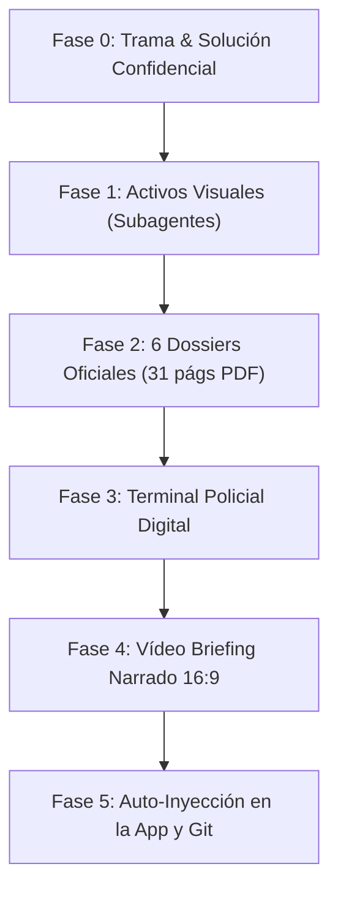

# 📋 PROTOCOLO MAESTRO DE GENERACIÓN DE CASOS VESTIGO™
> **Guía Ejecutable para la Creación Autónoma de Nuevos Casos de Investigación Criminal**  
> **Modo de Uso:** Cuando el usuario indique *"Crea un nuevo caso: [Título / Idea / Ubicación]"*, el agente debe leer este protocolo de principio a fin y ejecutar las 6 fases de forma autónoma con la máxima profundidad, rigor forense y calidad técnica, integrándolo automáticamente en la App VESTIGO.

---

## ⚖️ REGLA DE ORO INVIOLABLE (ZERO-SPOILERS)
* **El usuario es el investigador que va a jugar el caso.**
* **BAJO NINGÚN CONCEPTO** se debe revelar en las respuestas del chat, en la interfaz pública de la app, en los dossiers del Sobre A ni en el vídeo briefing la identidad del asesino, el móvil real ni la contradicción letal.
* La solución completa, el móvil, el cronograma al minuto y el razonamiento forense irrefutable se compilan **únicamente** en un archivo sellado: `casos/[id-caso]/SOLUCION_CONFIDENCIAL.md` (o en la raíz del caso correspondiente).

---

## 🏛️ ESTÁNDAR DE CALIDAD Y RIGOR TÉCNICO VESTIGO
Cada nuevo caso debe cumplir exactamente los mismos estándares que el caso piloto *«El Último Mosto de Bodegas Valdeluna»*:
1. **Verosimilitud Policial Española:** Procedimientos reales de la Guardia Civil (Policía Judicial), Juzgado de Instrucción, SECRIM, INTCF, DGT y peritos forenses.
2. **Cruce de Datos Científicos:** La solución no se basa en conjeturas, sino en física, química forense, medicina legal y cronometría matemática:
   - *Tanatología:* Concordancia o discordancia de livideces cadavéricas (traslado de cadáver).
   - *Cronotanatodiagnóstico:* Fase de digestión gástrica contrastada con horas de ingesta verificadas.
   - *Principio de Transferencia de Locard:* Micro-trazas químicas, biológicas o físicas transferidas entre el agresor, la víctima y los escenarios.
   - *Coartadas Cinemométricas:* Distancias en kilómetros, velocidades medias y capturas LPR de cámaras de tráfico reales.
3. **Estructura de 4 Sospechosos:**
   - 1 Culpable con una coartada aparentemente blindada pero con una fisura científica irrefutable.
   - 3 Inocentes con móviles reales (conflictos económicos, deudas, infidelidades, robos menores) y coartadas que al inicio parecen sospechosas pero que quedan demostradas al contrastar datos objetivos.

---

## 🔄 PIPELINE DE EJECUCIÓN PASO A PASO (6 FASES)

---

### FASE 0: Arquitectura de la Trama y Núcleo Secreto
1. **Ficha General:**
   - Número de Diligencias Previas / Sumario y Juzgado de Instrucción competente.
   - Fecha, hora exacta y ubicación geográfica verídica en España.
   - Víctima: Nombre, profesión de prestigio, perfil psicológico y patrimonio.
   - Hallazgo aparente (simulación de accidente, suicidio o muerte natural) vs. Homicidio real.
2. **Los 4 Investigados:**
   - Sospechoso 1: Familiar cercano / Socio financiero con móvil mercantil.
   - Sospechoso 2: Técnico / Empleado con resentimiento laboral.
   - Sospechoso 3: Testigo o figura externa con contradicciones horarias.
   - Sospechoso 4: Perfil frío / Profesional con coartada telemática aparentemente inexpugnable.
3. **Compilación de la Solución Secreta:**
   - Crear `SOLUCION_CONFIDENCIAL.md` detallando: Culpable, móvil, cronograma al minuto (hora del golpe, traslado, colocación), la contradicción fatal y el auto judicial definitivo.

---

### FASE 1: Generación de Imágenes Fotorrealistas (Subagente `image-generator`)
Invocar al subagente `image-generator` para crear 9 imágenes fotorrealistas con estética de documental policial:
1. **5 Retratos Biométricos (Mugshots):**
   - Retrato 1: La víctima (expresión madura, plano de filiación).
   - Retratos 2 a 5: Los 4 investigados (mirada seria, iluminación neutra de estudio policial, ropa acorde a su rol social/laboral).
2. **4 Fotografías Periciales de la Escena con Regla Métrica ABFO:**
   - Foto 1: Escena secundaria (donde se halló el cadáver con silueta de tiza y testigo métrico #1).
   - Foto 2: Escena primaria oculta (lugar real del homicidio con luminol o reactivo pericial y testigo métrico #2).
   - Foto 3: La pistola humeante de Locard (macrofotografía de calzado, alfombrilla, rueda o prenda con transferencia microscópica).
   - Foto 4: Escenario exterior de coartada (carretera, mirador, hotel o puerto tomado de noche).

---

### FASE 2: Los 6 Dossiers Oficiales Imprimibles (Formato A4)
Crear los archivos HTML de maquetación oficial y compilarlos a PDF mediante Microsoft Edge Headless (`--headless --print-to-pdf`):
1. **`INSTRUCCIONES_DE_JUEGO.pdf` (4 páginas):**
   - Manual de operaciones, montaje de mesa, flujo de sobres y decálogo de deducción forense.
2. **`SOBRE_A_PIEZA_PRINCIPAL.pdf` (6 páginas — Abierto de inicio):**
   - Providencia judicial de incoación.
   - Atestado policial inicial de primera intervención.
   - Autopsia preliminar completa en 2 hojas (Tanatología + Digestión).
   - Plano arquitectónico acotado en SVG de la escena.
   - Documento técnico de instalaciones (extractores, ventilación o maquinaria).
   - Albarán o ticket fiscal de la cena/última comida.
3. **`SOBRE_B_PIEZA_SEPARADA_1.pdf` (6 páginas — Precintado):**
   - Acta de inspección técnico-ocular con reactivo químico (BlueStar/Luminol).
   - 4 Actas de transcripción de interrogatorios policiales individuales.
   - Vaciado telemático de terminales móviles y chats de WhatsApp.
   - Informe técnico de telefonía y triangulación de antenas repetidoras (BTS).
   - Acta de incautación de efectos sustraídos o alterados.
4. **`SOBRE_C_PIEZA_CONVICCION.pdf` (4 páginas — Precintado):**
   - Dictamen pericial de documentoscopia e infrarrojos de la coartada aportada.
   - Reporte cinemométrico y capturas de cámaras LPR de la DGT.
   - Auditoría pericial contable de Delitos Económicos (UDEF) o peritaje técnico específico.
   - Dictamen definitivo de espectrometría química o ADN de SECRIM (INTCF).
5. **`EXTRAS_INMERSION.pdf` (5 páginas — Abierto de inicio):**
   - Fichas de filiación con retratos biométricos y huellas dactilares.
   - Recorte de prensa local de época/suceso verosímil.
   - Cuaderno de campo manuscrito del agente instructor.
   - Etiquetas oficiales recortables de cadena de custodia.
6. **`DOSSIER_NOTARIAL_Y_FORENSE.pdf` (6 páginas — Pieza Anexa):**
   - Escritura notarial con timbres FNMT, extractos bancarios oficiales, auditoría de accesos telemáticos (RFID/tarjetas) y álbum fotográfico pericial con regla métrica ABFO.

---

### FASE 3: Terminal Policial Digital Interactiva (SITRA-JUD)
Maquetar la terminal web adaptada al nuevo caso:
1. **Lector de Matrículas DGT LPR:** Registro de pasos con matrículas de los 4 sospechosos, horas, cinemómetros y cálculo de velocidades medias.
2. **Mapa Táctico SIG:** Cartografía de la zona con coordenadas reales de la escena, domicilios, antenas BTS y calculadora dinámica de tiempos de conducción.
3. **CCTV Perimetral:** Selector de cámaras con visión nocturna y registro cronológico de sensores de movimiento.
4. **Grabación de Audio:** Simulación sonora de la llamada de emergencia al 112.
5. **Validador Judicial:** Sistema de introducción de hipótesis para desbloquear las fases y abrir los Sobres B y C.
6. **Mesa de Ayuda:** Sistema de pistas progresivas (Niveles 1, 2 y 3).

---

### FASE 4: Vídeo Briefing Audiovisual Narrado (16:9)
Maquetar el reproductor cinematográfico en HTML5 con diseño responsive:
1. **HUD Policial:** Estética de circuito clasificado con código de tiempo, indicador `REC` y barrido CRT.
2. **Web Audio API:** Síntesis procedimental de banda sonora (drones subgraves a 55 Hz, acordes de tensión a 82.4 Hz, pulsos cardíacos y chasquidos analógicos).
3. **Web Speech API:** Locución hablada en castellano con subtítulos teletipo sincronizados.
4. **Estructura en 6 Actos (Cero Spoilers):**
   - Acto 1: La Noche del Suceso.
   - Acto 2: El Hallazgo de la Víctima.
   - Acto 3: Demolición de la Hipótesis Accidental (Falsa asfixia / falso suicidio).
   - Acto 4: Los 4 Sospechosos (Móviles y coartadas declaradas).
   - Acto 5: La Escena Primaria Oculta y el Principio de Locard.
   - Acto 6: Misión del Investigador e Instrucciones de Juego.

---

### FASE 5: Integración Automática en la App VESTIGO y GitHub
1. **Actualizar el Catálogo (`index.html`):**
   - Cambiar la tarjeta del nuevo caso de "Próximamente" a "Activo".
   - Asignar su identificador, sinopsis, etiquetas de jugadores, duración y botón de acceso.
2. **Habilitar el Espacio de Trabajo:**
   - Vincular sus pestañas de Briefing, Dossiers, Terminal, Sospechosos y Bloc de Notas.
3. **Actualizar `CONTEXTO_PROYECTO.md`:**
   - Registrar la nueva versión en el changelog vivo.
4. **Git Commit & Push:**
   - Ejecutar `git add .`, `git commit -m "feat: Caso [N] - [Título] completo"` y `git push origin main`.

---

## ⚡ FORMA RÁPIDA Y FÁCIL DE PEDIR UN NUEVO CASO (SHORTCUTS)

Para crear un caso nuevo sin tener que dar explicaciones técnicas, solo tienes que decir una de estas opciones:

### Opción A (Comando Rápido con Parámetros Básicos)
> **"VESTIGO: Crea el Caso 02 con estos datos:"**  
> - **Título:** [Ej. Marea Negra en Ría de Arousa]  
> - **Lugar:** [Ej. Cambados, Pontevedra]  
> - **Víctima:** [Ej. Patrón mayor de la cofradía de pescadores]  
> - **Tema:** [Ej. Contrabando, balizas GPS manipuladas y peritaje náutico]

### Opción B (Comando Ultra-Rápido 100% Autónomo)
> **"VESTIGO: Crea el Caso 02. Sorpréndeme con la temática y ejecútalo todo según el protocolo."**

El agente asumirá la dirección criminológica completa, diseñará la trama, generará las 9 imágenes, redactará las 31 páginas de expedientes, compilará los PDFs, programará la terminal y el vídeo briefing, lo inyectará en la app y lo subirá a GitHub automáticamente.
